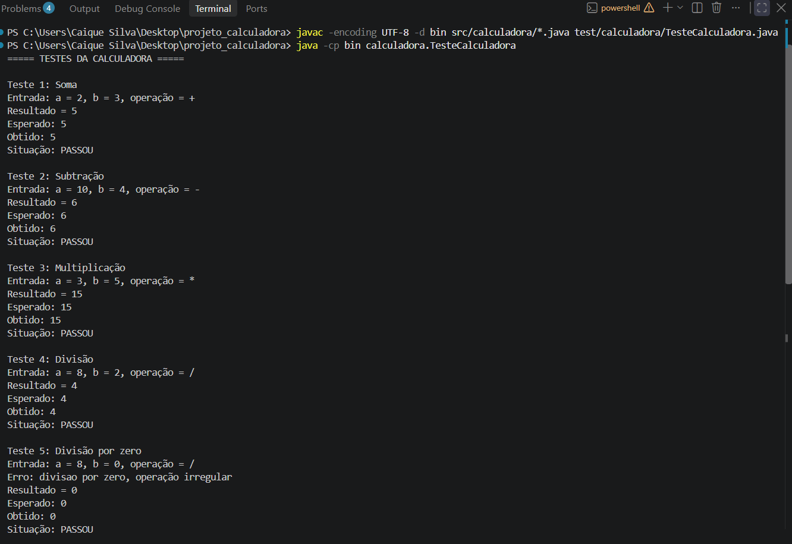
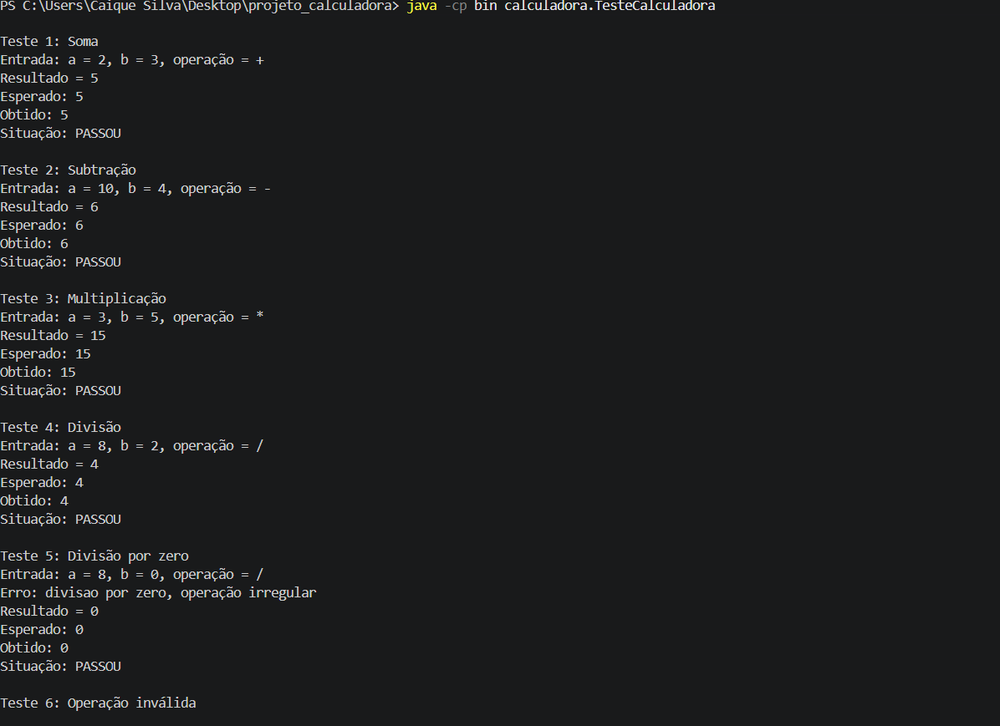
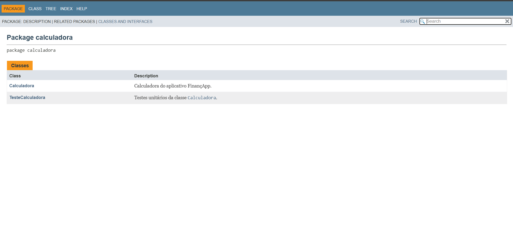
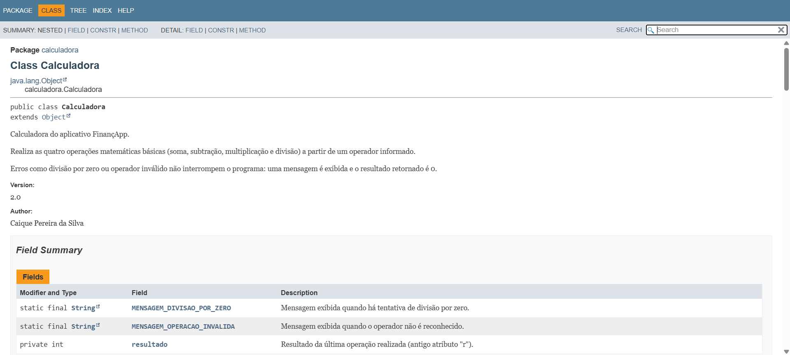

# Projeto Calculadora — FinançApp

> Projeto acadêmico desenvolvido com foco em Qualidade de Software, Testes, Refatoração, Documentação e Versionamento.

---

## 1. Identificação do Projeto

**Projeto:** Projeto Calculadora  
**Contexto:** FinançApp  
**Aluno:** Caique Pereira da Silva  
**RA:** 251874  
**Curso:** Análise e Desenvolvimento de Sistemas  
**Disciplina:** UX/UI e Testes de Software  
**Professor:** Daniel Ohata  
**Semestre:** 2026.2  

---

# 2. Visão Geral

O projeto consiste no desenvolvimento de um módulo de cálculos matemáticos básicos em Java para a startup fictícia **FinançApp**, que desenvolve um aplicativo de controle de finanças pessoais.

O módulo poderá ser usado em funcionalidades como orçamento mensal, divisão de despesas, projeções financeiras e cálculos auxiliares. Além das operações, o projeto aplica testes, tratamento de erros, refatoração, documentação e versionamento.

---

# 3. Problema

A FinançApp precisa de um módulo matemático reutilizável que, além de funcionar corretamente, tenha código legível, testes, tratamento de falhas, documentação técnica, controle de versões e facilidade de manutenção.

---

# 4. Objetivo

## 4.1 Objetivo Geral

Desenvolver uma calculadora em Java aplicando práticas de qualidade, testes, documentação, refatoração e versionamento.

## 4.2 Objetivos Técnicos

- implementar operações matemáticas básicas;
- tratar entradas inválidas;
- impedir divisão por zero;
- desenvolver testes;
- refatorar o código sem alterar seu comportamento;
- documentar classes e métodos com JavaDoc;
- gerar documentação HTML;
- utilizar Git e GitHub.

---

# 5. Escopo Funcional

| ID | Funcionalidade | Descrição | Status |
|---|---|---|---|
| RF01 | Soma | Soma dois números inteiros | ✅ |
| RF02 | Subtração | Subtrai dois números inteiros | ✅ |
| RF03 | Multiplicação | Multiplica dois números inteiros | ✅ |
| RF04 | Divisão | Divide dois números inteiros | ✅ |
| RF05 | Validação de divisão | Impede divisão por zero | ✅ |
| RF06 | Operação inválida | Trata operadores não suportados | ✅ |

## 5.1 Explicação das operações

O método `calc(int a, int b, String op)` recebe dois números e o operador, exibe e retorna o resultado.

| Operador | Operação | Exemplo | Resultado |
|---|---|---|---|
| `+` | Soma | `calc(2, 3, "+")` | `5` |
| `-` | Subtração | `calc(10, 4, "-")` | `6` |
| `*` | Multiplicação | `calc(3, 5, "*")` | `15` |
| `/` | Divisão (inteira) | `calc(8, 2, "/")` | `4` |
| `/` por zero | Erro tratado | `calc(8, 0, "/")` | mensagem de erro e `0` |
| outro | Erro tratado | `calc(5, 5, "x")` | `Operacao invalida` e `0` |

Nenhum erro interrompe a execução do programa.

---

# 6. Requisitos Não Funcionais

| ID | Categoria | Requisito |
|---|---|---|
| RNF01 | Qualidade | O código deve possuir organização e legibilidade |
| RNF02 | Testabilidade | As operações devem possuir testes |
| RNF03 | Manutenção | O código deve permitir refatoração sem alteração funcional |
| RNF04 | Documentação | Classes e métodos devem possuir JavaDoc |
| RNF05 | Versionamento | O projeto deve utilizar Git e GitHub |
| RNF06 | Confiabilidade | Erros não devem interromper inesperadamente a execução |

---

# 7. Tecnologias Utilizadas

| Tecnologia | Versão | Utilização |
|---|---|---|
| Java / JDK | (sua versão, ex.: 21) | Desenvolvimento e compilação |
| Testes | — | Classe `TesteCalculadora` em Java puro |
| Git | (sua versão) | Controle de versão |
| GitHub | — | Repositório remoto |
| JavaDoc | (mesma do JDK) | Documentação |
| IDE | Visual Studio Code | Ambiente de desenvolvimento |

---

# 8. Estrutura do Projeto

```text
projeto_calculadora/
├── src/calculadora/Calculadora.java
├── test/calculadora/TesteCalculadora.java
├── docs/index.html
├── images/
│   ├── testes/
│   ├── javadoc/
│   └── refatoracao/
├── README.md
└── .gitignore
```

---

# 9. Testes

Cada teste mostra a entrada, o resultado esperado, o resultado obtido e se passou.

Versão original (branch `main`):



Após a refatoração, sem alterar os testes (o comportamento continua o mesmo):



Versão final, com o teste de operador nulo:


---

# 10. Refatoração

Feita na branch `Refatoracao`:

| Técnica | Antes | Depois |
|---|---|---|
| Extração de métodos | Tudo dentro de `calc` | `somar`, `subtrair`, `multiplicar`, `dividir`, `executarOperacao` |
| Simplificação de condicionais | Cadeia de `if/else` | `switch` |
| Melhoria nos nomes | `r` | `resultado` e constantes para as mensagens |
| Organização lógica | Cálculo e erro misturados | Erros tratados com `try/catch` |
| Correção | Operador `null` travava o programa | `null` tratado como operação inválida |


---

# 11. Documentação JavaDoc

A documentação foi gerada na pasta `docs/` (branch `Refatoracao`).






---

# 12. Repositório

https://github.com/cacaPsilva/projeto_calculadora

